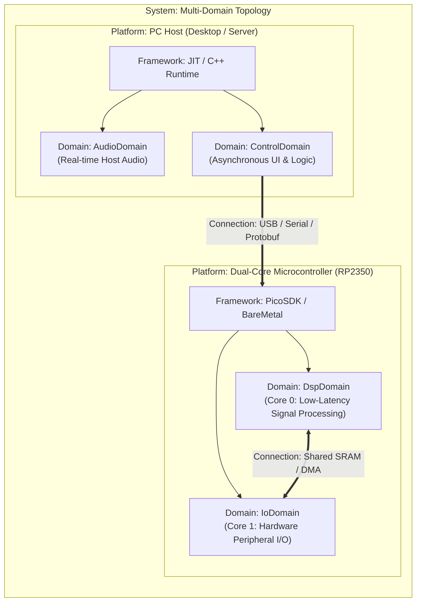

# Systems, Frameworks, Platforms, and Domains

Stride formalizes the division between physical hardware, toolchains, computation scheduling, and system topology into four distinct architectural concepts:



---

## 1. Architectural Taxonomy

| Concept | What It Represents | Key Responsibilities | Examples |
| :--- | :--- | :--- | :--- |
| **Platform** | **Hardware Support** | Hardware descriptions, device pinouts, peripherals, registers, memory layouts, DMA controllers, interrupt vectors. | `RP2040`, `RP2350`, `STM32F4`, `Local_x86_64` |
| **Framework** | **Toolchain & Runtime** | Code emission targets, compiler backends, platform modules, language operator lowerings, runtime library bindings. | `JIT`, `Cpp`, `RtAudio`, `Wiring`, `PicoSDK` |
| **System** | **Deployment Topology** | Groups platforms and frameworks into a whole; declares abstract **Connections** between disparate execution targets. | `DesktopApp`, `DesktopAudioApp`, `DualCoreBldcSystem` |
| **Domain** | **Computation Group** | Execution context for signals, streams, and state machines; bound to a **Framework**; requires and provides **Resources**. | `AudioDomain`, `ControlDomain`, `GuiDomain`, `RootDomain` |

---

## 2. Platforms: Hardware Abstraction

A **Platform** (`platform`) encapsulates target hardware capabilities and physical resources. It defines the physical substrate:
- Processor cores (ARM Cortex-M, RISC-V, x86_64), clock frequencies, and cache structures.
- Memory topologies: SRAM banks, flash boundaries, tightly-coupled memories (TCM), zero-latency scratchpads (zpads).
- Peripheral bindings: GPIOs, ADC/DAC channels, SPI/I2C/UART controllers.

```stride
platform _PicoPlatform {
    framework: "Pico"
    frameworkVersion: "1.0"
    hardware: "RP2040"
    hardwareVersion: "1.0"
}
```

---

## 3. Domains: Thread & Rate Isolation

A **Domain** represents a single thread of execution, core, or rate context:

* Real-time audio domains run inside high-priority interrupts or dedicated DSP cores without heap allocations.
* Control domains run asynchronously or inside background scheduler loops.

When streams cross domain boundaries, Stride enforces synchronization mechanisms:
- **Semaphores & Mutexes**: For buffer pool leases and atomic resource locks.
- **Double-Buffer Ping-Pong**: For DMA transfers without latency jitter.
- **Ring Buffers / FIFOs**: For asynchronous event and message streams.
